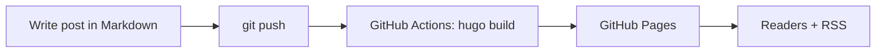

I spend most of my days in cloud infrastructure: Terraform, Kubernetes, CI pipelines, incident channels and the occasional vulnerability fire drill. This blog is where I'll write up what I learn along the way, for people doing the same work in security, DevOps and SRE.

## What to expect

- **Infrastructure as code:** patterns that held up in production, and ones that didn't.
- **Incidents:** what broke, how we found it, what we changed.
- **Security in the pipeline:** dependency hygiene, scanning, least privilege.
- **Tooling:** small scripts and tools that save time.

## How this site ships

The site is built with [Hugo](https://gohugo.io/) and the [PaperMod](https://github.com/adityatelange/hugo-PaperMod) theme. Every push to `main` triggers a GitHub Actions workflow that builds the site and deploys it to GitHub Pages.



Writing a post is just this:

```bash
hugo new content posts/my-new-post.md
hugo server -D        # preview at http://localhost:1313
git add . && git commit -m "post: my new post" && git push
```

And because no infrastructure post is complete without some Terraform:

```hcl
resource "aws_s3_bucket_public_access_block" "logs" {
  bucket                  = aws_s3_bucket.logs.id
  block_public_acls       = true
  block_public_policy     = true
  ignore_public_acls      = true
  restrict_public_buckets = true
}
```

Subscribe via [RSS](/index.xml) if you want new posts as they land.
